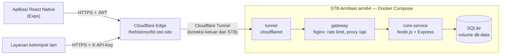

# TheHistoryOfIndonesia — Learning Path Service

Backend microservice untuk aplikasi **TheHistoryOfIndonesia**, aplikasi belajar sejarah Indonesia (video YouTube + ringkasan + kuis) untuk **umum: siapa saja yang penasaran dengan sejarah Indonesia**, dengan gaya belajar ala Duolingo (tes awal, lewati era yang sudah dikuasai).
Tugas Besar II3160 Teknologi Sistem Terintegrasi × II3140 Pengembangan Aplikasi Web & Mobile, ITB — kelas K02.

| | |
|---|---|
| **URL API** | `https://thehistoryofid.stei.site/api` |
| **Dokumentasi interaktif (Swagger UI)** | `https://thehistoryofid.stei.site/api/docs` |
| **Spesifikasi OpenAPI** | `https://thehistoryofid.stei.site/api/openapi.yaml` |
| **Health check** | `https://thehistoryofid.stei.site/api/health` |

---

## 1. Deskripsi

**Learning Path Service** mengelola jalur belajar sejarah Indonesia: era → bab → materi (video + ringkasan) → kuis.
Service menegakkan aturan belajar di server:

1. Era ke-n terbuka jika semua bab di era ke-(n−1) sudah **selesai atau dilewati (`skipped`)**. Era pertama selalu terbuka. Era juga terbuka jika pengguna lulus **tes lompat** era itu.
2. Kuis lulus jika skor **≥ 70** (dari 100). Percobaan tidak dibatasi; yang disimpan nilai tertinggi.
3. Kunci jawaban **tidak pernah** dikirim ke aplikasi sebelum submit; penilaian dilakukan di server.
4. Bab selesai jika video sudah ditandai ditonton **dan** kuis lulus.
5. Lencana era diberikan jika era tuntas **lewat kuis bab** (tidak ada bab yang dilewati) dengan rata-rata nilai **≥ 90**.
6. Akses bab/kuis di era yang masih terkunci ditolak dengan **403 `ERA_LOCKED`**.
7. **Tes awal (placement test):** ±2 soal acak per era. Era dengan skor **≥ 80** dianggap dikuasai: semua babnya berstatus `skipped`. Hanya bisa sekali (bisa diulang dari Profil › Ulangi tes awal).
8. **Tes lompat (test-out):** kuis gabungan satu era, boleh kapan saja. Skor **≥ 80** → era terbuka dan semua babnya dilewati.
9. Status bab: `locked | available | in_progress | completed | skipped`. `completed` (video + kuis) menang atas `skipped` bila pengguna mengerjakan bab yang tadinya dilewati.

### Bounded context (Domain-Driven Design)

| Bounded context | Folder | Tanggung jawab |
|---|---|---|
| Curriculum | `core-service/src/curriculum` | Era, bab, video YouTube, ringkasan, urutan |
| Historical Knowledge | `core-service/src/knowledge` | Peristiwa & tokoh (tahun, lokasi, koordinat) |
| Assessment | `core-service/src/assessment` | Soal pilihan ganda, penilaian, riwayat percobaan, draf soal AI + persetujuan admin |
| Learning Progress | `core-service/src/progress` | Status tonton, kelulusan bab, pembukaan era, lencana, tes awal & tes lompat (`skipped`) |
| Identity & Access | `core-service/src/identity` | Akun, JWT, role, API key kelompok lain |
| Open Host Service | `core-service/src/public` | API publik stabil untuk kelompok lain |
| Integrasi eksternal | `core-service/src/integrations` | Klien Gemini API & Wikipedia (diinjeksi, mudah dipalsukan di test) |

**Stack:** Node.js 22 LTS, Express 5, SQLite (better-sqlite3), zod (validasi), bcrypt, JWT, Swagger UI, Jest + supertest, Nginx, Cloudflare Tunnel, Docker Compose di STB Armbian arm64.

## 2. Arsitektur



| Container | Image | Batas resource | Port |
|---|---|---|---|
| `core-service` | build dari `core-service/Dockerfile` (node:22-bookworm-slim) | 256 MB, 0.5 CPU | 3000 (internal saja) |
| `gateway` | nginx:1.27-alpine | 64 MB, 0.25 CPU | 80 (internal), `127.0.0.1:8080` di STB |
| `tunnel` | cloudflare/cloudflared | 64 MB, 0.25 CPU | tidak ada (koneksi keluar) |

Semua container memakai `restart: unless-stopped` dan image yang mendukung arm64. Tidak ada port yang dibuka ke internet; database hanya berupa file di volume dan tidak punya port.

## 3. Daftar endpoint

Base URL: `https://thehistoryofid.stei.site/api`

### Publik & autentikasi

| Method | Path | Auth | Keterangan |
|---|---|---|---|
| GET | `/health` | – | Status service |
| POST | `/auth/register` | – | Daftar akun → `{ user, token }` |
| POST | `/auth/login` | – | Login → `{ user, token }` |
| GET | `/me` | JWT | Profil |
| PUT | `/me` | JWT | Ubah `name` / pilih `avatarId` (avatar bawaan: `candi`, `keris`, `wayang`, `pinisi`, `batik`, `gunungan`, `rumah-gadang`, `garuda`; `null` = inisial). URL foto **tidak** didukung lagi |

### Belajar (aplikasi)

| Method | Path | Auth | Keterangan |
|---|---|---|---|
| GET | `/eras` | JWT | Semua era + status `locked` / `unlocked` / `completed`; era terkunci membawa `lock` (alasan + `testOutAvailable`) |
| GET | `/eras/:id/chapters` | JWT | Bab di era + status tiap bab |
| GET | `/chapters/:id` | JWT | Video, ringkasan, peristiwa & tokoh terkait, `wikiSummary` (403 jika era terkunci) |
| GET | `/items/:id` | JWT | Detail peristiwa/tokoh + `wikiSummary` |
| POST | `/chapters/:id/watched` | JWT | Tandai video sudah ditonton |
| GET | `/chapters/:id/quiz` | JWT | Soal **tanpa** kunci jawaban |
| POST | `/chapters/:id/quiz/submit` | JWT | → `{ score, passed, results[], eraUnlocked, badgeEarned, ... }` |
| GET | `/me/progress` | JWT | Ringkasan progres, lencana, status semua era & bab |

### Tes awal & tes lompat (aplikasi)

| Method | Path | Auth | Keterangan |
|---|---|---|---|
| GET | `/me/placement` | JWT | Sudah tes awal atau belum + hasil terakhir |
| GET | `/placement` | JWT | Soal tes awal (±2 per era, tanpa kunci). 409 `PLACEMENT_ALREADY_TAKEN` bila sudah pernah, kecuali `?retake=true` |
| POST | `/placement/submit` | JWT | Nilai per era; era ≥ 80 dikuasai & dilewati → `{ eras[], masteredEras[], startEra, ... }` |
| GET | `/eras/:id/test-out` | JWT | Kuis gabungan satu era (boleh untuk era terkunci) |
| POST | `/eras/:id/test-out` | JWT | Skor ≥ 80 → era terbuka & bab dilewati → `{ score, passed, unlockedEras[], results[] }` |

### Admin (JWT role `admin`)

| Method | Path | Keterangan |
|---|---|---|
| GET / POST | `/admin/eras` | Daftar / buat era |
| PUT / DELETE | `/admin/eras/:id` | Ubah / hapus era |
| POST | `/admin/chapters` | Buat bab |
| PUT / DELETE | `/admin/chapters/:id` | Ubah (mis. ganti `videoUrl`) / hapus bab |
| GET / POST | `/admin/chapters/:id/questions` | Daftar soal semua status (dengan kunci) / tambah soal |
| POST | `/admin/chapters/:id/generate-quiz` | **AI:** buat soal dengan Gemini, disimpan sebagai **draf** (lihat bagian 3b) |
| POST | `/admin/questions/:id/approve` | Setujui soal draf agar dipakai di kuis |
| POST | `/admin/chapters/:id/wiki-draft` | Draf ringkasan bab dari Wikipedia (tidak disimpan otomatis) |
| PUT / DELETE | `/admin/questions/:id` | Ubah / hapus soal |
| GET / POST | `/admin/api-keys` | Daftar / terbitkan API key kelompok lain |
| DELETE | `/admin/api-keys/:id` | Cabut API key |

### Open Host Service untuk kelompok lain (header `X-API-Key`)

| Method | Path | Keterangan |
|---|---|---|
| GET | `/public/eras` | Daftar era |
| GET | `/public/learning-path` | Era + bab berurutan (`step` 1..n) |
| GET | `/public/quiz?topic=majapahit&limit=5` | Soal **dengan** kunci jawaban & pembahasan (limit 1–20) |
| GET | `/public/events?keyword=...&kind=event\|figure&limit=20` | Peristiwa/tokoh + tahun + lokasi + koordinat |
| GET | `/public/recommendations?chapterId=...&limit=3` | Bab lanjutan dalam learning path |

### Format error

Semua error memakai format yang sama:

```json
{ "error": { "code": "ERA_LOCKED", "message": "Era \"Kerajaan Islam\" masih terkunci. ..." } }
```

| Status | Kode yang mungkin |
|---|---|
| 400 | `VALIDATION_ERROR` (disertai `details[]`), `INVALID_JSON`, `QUIZ_EMPTY`, `TEST_NOT_STARTED`, `WIKI_TITLE_REQUIRED` |
| 401 | `UNAUTHORIZED`, `INVALID_TOKEN`, `INVALID_CREDENTIALS`, `API_KEY_REQUIRED`, `INVALID_API_KEY` |
| 403 | `FORBIDDEN`, `ERA_LOCKED`, `API_KEY_REVOKED` |
| 404 | `NOT_FOUND` |
| 409 | `CONFLICT`, `PLACEMENT_ALREADY_TAKEN`, `ERA_ALREADY_DONE`, `TEST_EXPIRED` |
| 429 | `RATE_LIMITED` (dari Nginx), `AI_QUOTA_EXCEEDED` (kuota Gemini habis) |
| 502 / 504 | `AI_UNREACHABLE`, `AI_AUTH_FAILED`, `AI_UPSTREAM_ERROR`, `AI_INVALID_RESPONSE`, `AI_EMPTY_RESPONSE`, `WIKI_UNAVAILABLE`, `AI_TIMEOUT` |
| 500 / 503 | `INTERNAL_ERROR`, `SERVICE_UNAVAILABLE`, `AI_NOT_CONFIGURED` |

### 3b. Integrasi eksternal

**Generator kuis dengan Gemini (hanya admin).** Aturan dosen: model AI **tidak berjalan di STB**; backend hanya **memanggil API Gemini** lewat internet, dengan kunci di `.env` (`GEMINI_API_KEY`, tidak pernah di-commit; dikirim lewat header, bukan URL).

1. `POST /api/admin/chapters/:id/generate-quiz` dengan body `{ "count": 5 }` (1–10). Backend mengirim judul + ringkasan bab ke Gemini dan meminta JSON terstruktur (`responseSchema`).
2. Keluaran **divalidasi** lagi di server: tepat 4 opsi, opsi tidak kembar, `answerIndex` 0–3, pembahasan ada, bukan duplikat soal yang sudah ada. Soal yang gagal dibuang dan dilaporkan di `rejected[]`. Urutan opsi diacak di server supaya kunci tidak condong ke satu posisi.
3. Soal disimpan sebagai **draf**: kolom `source = 'ai'`, `status = 'draft'`. Draf **tidak muncul** di kuis, tes awal, tes lompat, maupun API publik sampai admin memanggil `POST /api/admin/questions/:id/approve` (supaya tidak ada soal sejarah yang salah).
4. Soal tersimpan dipakai ulang dari database. **Gemini tidak dipanggil** ketika pengguna membuka atau mengerjakan kuis (hemat kuota, cepat).
5. Kegagalan memberi error jelas dan **tidak mengganggu fitur lain**: `AI_NOT_CONFIGURED` 503, `AI_QUOTA_EXCEEDED` 429, `AI_TIMEOUT` 504, `AI_INVALID_RESPONSE` / `AI_UNREACHABLE` / `AI_AUTH_FAILED` 502.

Variabel `.env`: `GEMINI_API_KEY` (wajib untuk fitur ini), `GEMINI_MODEL` (default `gemini-2.5-flash`), `GEMINI_TIMEOUT_MS` (default 25000).

**Materi dari Wikipedia.** Modul `src/integrations/wikipedia.js` memanggil `https://id.wikipedia.org/api/rest_v1/page/summary/<judul>` dengan header `User-Agent` yang jelas (`WIKI_USER_AGENT`). Bab dan tokoh/peristiwa punya kolom `wiki_title`; `GET /api/chapters/:id` dan `GET /api/items/:id` menambahkan `wikiSummary` (`extract`, `url`, atribusi CC BY-SA 4.0). Hasil di-**cache di database** (tabel `wiki_cache`) selama 7 hari (`WIKI_CACHE_DAYS`); artikel yang tidak ditemukan di-cache 1 hari. Jika Wikipedia gagal, materi tetap dikembalikan dengan `wikiSummary: null` (atau cache lama bila ada), tidak error.

**Database lama (STB).** Kolom baru ditambahkan otomatis saat service start (migrasi ringan di `src/db/index.js`) dan `wiki_title` diisi untuk data yang sudah ada, sehingga **tidak perlu** `seed:reset` (yang akan menghapus progres).

## 4. Autentikasi

**Aplikasi (JWT).** Login atau register untuk mendapatkan `token` (berlaku 7 hari), lalu kirim di setiap request:

```
Authorization: Bearer <token>
```

Password disimpan sebagai hash bcrypt. Role `student` (ditampilkan sebagai "Pengguna" di aplikasi) didapat dari registrasi; role `admin` hanya dari seed.

**Kelompok lain (API key).** Kirim header:

```
X-API-Key: <key kelompok Anda>
```

Satu key per kelompok. Server hanya menyimpan hash SHA-256 dari key, sehingga key asli tidak bisa dibaca dari database. Key bisa dirotasi atau dicabut oleh admin; key yang dicabut mendapat `403 API_KEY_REVOKED`.

### Cara meminta API key

1. Hubungi kelompok TheHistoryOfIndonesia (anggota A — Backend) dan sebutkan nama layanan Anda, misalnya `classroom-service`.
2. Admin menerbitkan key lewat `POST /api/admin/api-keys` dengan body `{ "clientName": "classroom-service" }`.
3. Key dikirim ke Anda lewat kanal privat (bukan grup publik). Key **hanya ditampilkan sekali**; jika hilang, minta diterbitkan ulang (key lama otomatis tidak berlaku).

Kelompok mitra yang sudah terdaftar: `classroom-service` dan `tourism-language`.

## 5. Contoh request

```bash
API=https://thehistoryofid.stei.site/api

# Login
curl -s -X POST $API/auth/login -H "Content-Type: application/json" \
  -d '{"email":"siswa@thehistoryofid.test","password":"<password>"}'
# -> {"user":{"id":2,"email":"siswa@thehistoryofid.test","name":"Pengguna Uji","role":"student",...},"token":"eyJhbGciOi..."}

TOKEN=eyJhbGciOi...

# Daftar era + status
curl -s $API/eras -H "Authorization: Bearer $TOKEN"
# -> {"data":[{"id":1,"title":"Kerajaan Hindu-Buddha","status":"unlocked","chapterCount":3,...},
#             {"id":2,"title":"Kerajaan Islam","status":"locked",...}, ...]}

# Soal kuis (tanpa kunci jawaban)
curl -s $API/chapters/1/quiz -H "Authorization: Bearer $TOKEN"
# -> {"chapterId":1,"passingScore":70,"questions":[{"id":1,"question":"Tujuh prasasti ...","options":["Prasasti Ciaruteun","Prasasti Yupa",...]}, ...]}

# Submit jawaban
curl -s -X POST $API/chapters/1/quiz/submit -H "Authorization: Bearer $TOKEN" \
  -H "Content-Type: application/json" \
  -d '{"answers":[{"questionId":1,"selectedIndex":1},{"questionId":2,"selectedIndex":2}]}'
# -> {"score":40,"passed":false,"passingScore":70,"bestScore":40,"chapterCompleted":false,
#     "eraUnlocked":null,"badgeEarned":null,"results":[{"questionId":1,"correct":true,"correctIndex":1,"explanation":"..."}, ...]}

# Akses bab di era terkunci
curl -s $API/chapters/4 -H "Authorization: Bearer $TOKEN"
# -> 403 {"error":{"code":"ERA_LOCKED","message":"Era \"Kerajaan Islam\" masih terkunci. ..."}}

# Kelompok lain: soal Majapahit beserta kunci jawaban
curl -s "$API/public/quiz?topic=majapahit&limit=2" -H "X-API-Key: <key>"
# -> {"topic":"majapahit","count":2,"data":[{"id":15,"chapterTitle":"Majapahit","question":"...",
#     "options":[...],"answerIndex":1,"answer":"Mpu Prapanca","explanation":"..."}, ...]}

# Kelompok lain: peristiwa & tokoh
curl -s "$API/public/events?keyword=gajah%20mada" -H "X-API-Key: <key>"
# -> {"count":2,"data":[{"kind":"event","name":"Sumpah Palapa","year":1336,"location":"Trowulan, Mojokerto",
#     "region":"Jawa Timur","coordinates":{"lat":-7.56,"lng":112.38},"chapters":[{"id":3,"title":"Majapahit"}]}, ...]}
```

Daftar lengkap request dan response ada di Swagger UI (`/api/docs`).

## 6. Akun uji

| Role | Email | Password |
|---|---|---|
| admin | `admin@thehistoryofid.test` | nilai `SEED_ADMIN_PASSWORD` di `.env` |
| student (pengguna umum) | `siswa@thehistoryofid.test` | nilai `SEED_STUDENT_PASSWORD` di `.env` |

Password tidak ditulis di repo; minta ke kelompok kami bila diperlukan untuk penilaian. Semua data adalah data uji, bukan data pribadi asli. Video hanya berupa tautan YouTube.

## 7. Rate limit

Diterapkan di Nginx (`gateway/nginx.conf`) per IP pengguna asli (header `CF-Connecting-IP` dari Cloudflare):

| Lokasi | Batas | Burst |
|---|---|---|
| `/api/auth/*` (login, register) | 5 request / menit | 5 |
| `/api/*` lainnya | 10 request / detik | 20 |
| Koneksi bersamaan | 20 per IP | – |

Melebihi batas → `429 {"error":{"code":"RATE_LIMITED",...}}` dengan header `Retry-After`.

## 8. Menjalankan secara lokal

Butuh Node.js ≥ 22.

```bash
cp .env.example .env          # isi nilai; untuk lokal set NODE_ENV=development dan kosongkan DB_PATH
cd core-service
npm install
npm run seed                  # isi database (otomatis juga saat start jika kosong)
npm run dev                   # http://localhost:3000/api/health  dan  /api/docs
npm test                      # 57 test Jest + supertest (tidak butuh internet; Gemini & Wikipedia dipalsukan)
```

Perintah lain: `npm run seed:reset` (isi ulang konten & hapus progres), `node src/db/backup.js` (backup database).

Dengan Docker (tanpa tunnel):

```bash
docker compose up --build core-service gateway
curl http://localhost:8080/api/health
```

## 9. Deploy ke STB (Armbian arm64)

### 9.1 Push kode ke GitHub (di laptop)

```bash
git add . && git commit -m "pesan" && git push origin main
```

### 9.2 Masuk ke STB dan siapkan Docker

```bash
ssh <user>@<ip-stb>
uname -m                       # harus: aarch64
docker --version && docker compose version
# jika belum ada Docker:
curl -fsSL https://get.docker.com | sudo sh
sudo usermod -aG docker $USER  # lalu logout & login ulang
```

### 9.3 Clone repo dan isi `.env`

```bash
git clone https://github.com/<akun>/The-History-Of-Indonesia-TST-x-PAWM-.git thehistoryofid
cd thehistoryofid
cp .env.example .env
openssl rand -hex 32           # jalankan beberapa kali untuk JWT_SECRET, password, dan API key
nano .env                      # isi semua nilai "ganti-..." dan TUNNEL_TOKEN
chmod 600 .env
```

### 9.4 Buat Cloudflare Tunnel

1. Buka Cloudflare dashboard → **Zero Trust** → **Networks** → **Tunnels** → **Create a tunnel** → pilih **Cloudflared**.
2. Beri nama, misalnya `thehistoryofid`.
3. Pada langkah instalasi, salin **token** (string panjang setelah `--token`) ke `TUNNEL_TOKEN` di `.env`. Perintah instalasinya tidak perlu dijalankan, karena cloudflared sudah berjalan sebagai container.
4. Tab **Public Hostname** → **Add a public hostname**:
   - Subdomain: `thehistoryofid`, Domain: `stei.site`
   - Service: Type `HTTP`, URL `gateway:80`
5. Simpan.

> Jika domain `stei.site` dikelola asisten/dosen, ikuti instruksi mereka untuk mendapatkan token tunnel; yang penting service-nya diarahkan ke `http://gateway:80`.

### 9.5 Jalankan

```bash
docker compose up -d --build   # build pertama di STB bisa beberapa menit
docker compose ps              # ketiga container harus "running", core-service "healthy"
curl http://127.0.0.1:8080/api/health
curl https://thehistoryofid.stei.site/api/health
```

### 9.6 Operasional

```bash
# Log
docker compose logs -f core-service
docker compose logs --tail=100 gateway
docker compose logs tunnel | grep -i -E "registered|error"

# Pemakaian resource (cek batas 256m / 64m)
docker stats --no-stream

# Update setelah push kode baru
git pull && docker compose up -d --build

# Restart satu service
docker compose restart core-service

# Backup database (aman walau service berjalan)
docker compose exec core-service node src/db/backup.js
docker compose cp core-service:/data/. ./backup/          # salin ke host STB
# lalu dari laptop: scp <user>@<ip-stb>:~/thehistoryofid/backup/backup-*.db .

# Restore: hentikan service, salin file backup sebagai /data/app.db, jalankan lagi
docker compose stop core-service
docker compose cp ./backup/backup-XXXX.db core-service:/data/app.db
docker compose start core-service
```

### 9.7 Ganti video placeholder

Seed memakai tautan `https://www.youtube.com/watch?v=TODO-...`. Ganti dengan video asli lewat admin API:

```bash
curl -X PUT $API/admin/chapters/1 -H "Authorization: Bearer $ADMIN_TOKEN" \
  -H "Content-Type: application/json" -d '{"videoUrl":"https://www.youtube.com/watch?v=VIDEO_ID"}'
```

## 10. Struktur repo

```
├─ core-service/
│  ├─ src/
│  │  ├─ identity/  curriculum/  knowledge/  assessment/  progress/  public/   (bounded context)
│  │  ├─ shared/    (error, middleware auth & validasi, skema zod)
│  │  ├─ db/        (schema.sql, seed, seed-data, backup)
│  │  ├─ app.js     server.js   config.js   docs.js
│  ├─ tests/        (Jest + supertest)
│  ├─ openapi.yaml  Dockerfile  package.json
├─ gateway/nginx.conf
├─ docker-compose.yml
├─ .env.example
└─ README.md
```
