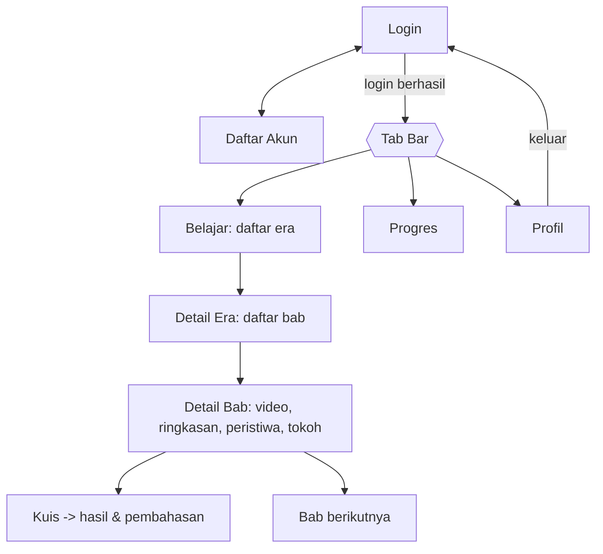

# TheHistoryOfIndonesia — Aplikasi Mobile (Expo)

Aplikasi React Native (Expo SDK 58, Expo Router) untuk belajar sejarah Indonesia.
Seluruh data diambil dari backend kelompok sendiri (`core-service`, lihat README di root repo).

## Layar & navigasi



| Layar | File | Endpoint API |
|---|---|---|
| Login | `src/app/login.js` | `POST /auth/login` |
| Daftar Akun | `src/app/register.js` | `POST /auth/register` |
| Belajar (daftar era) | `src/app/(tabs)/index.js` | `GET /eras` |
| Detail Era | `src/app/era/[id].js` | `GET /eras/:id/chapters` |
| Detail Bab | `src/app/chapter/[id].js` | `GET /chapters/:id`, `POST /chapters/:id/watched` |
| Kuis | `src/app/quiz/[id].js` | `GET /chapters/:id/quiz`, `POST /chapters/:id/quiz/submit` |
| Progres | `src/app/(tabs)/progress.js` | `GET /me/progress` |
| Profil | `src/app/(tabs)/profile.js` | `GET /me`, `PUT /me` |

- Navigasi: Expo Router (file-based). `Stack.Protected` menjaga layar belajar hanya bisa dibuka setelah login.
- Login: JWT disimpan di `expo-secure-store` (Keychain/Keystore), sehingga tidak perlu login ulang.
- Video: embed YouTube lewat `react-native-webview`.

## Menjalankan di HP (Expo Go)

1. Jalankan backend: `cd core-service && npm run dev`.
2. Salin `.env.example` ke `.env`, isi `EXPO_PUBLIC_API_URL`:
   - uji dengan laptop: `http://<IP-laptop>:3000/api` (HP & laptop satu jaringan/hotspot)
   - produksi: `https://thehistoryofid.stei.site/api`
3. ```bash
   cd mobile-app
   npm install
   npx expo start
   ```
   Jika Expo memilih IP yang salah (ada VirtualBox/VMware), jalankan di PowerShell:
   `$env:REACT_NATIVE_PACKAGER_HOSTNAME="<IP-laptop>"; npx expo start`
4. Scan QR code dengan Kamera iPhone (atau aplikasi Expo Go di Android).
