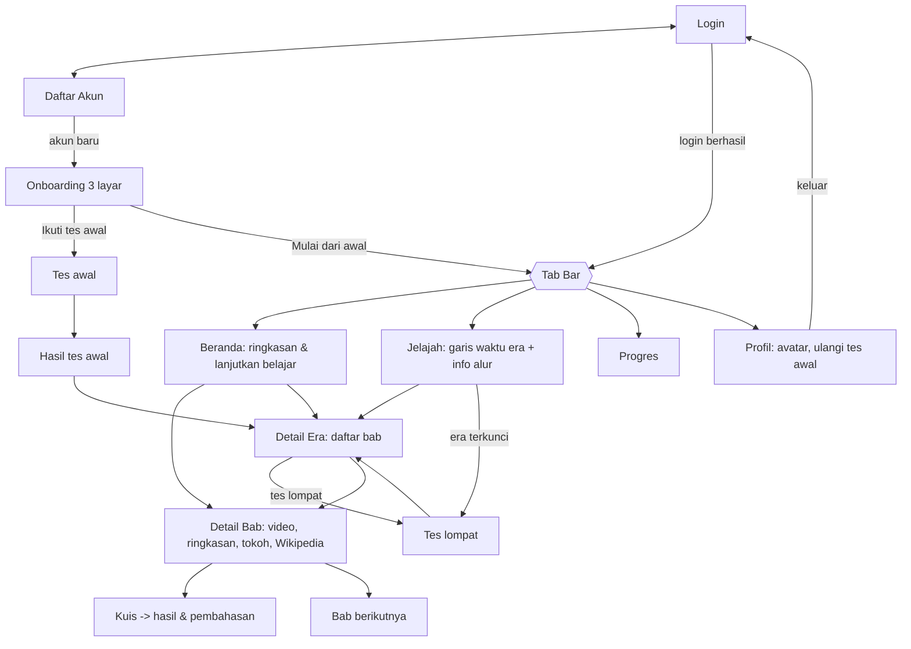

# TheHistoryOfIndonesia — Aplikasi Mobile (Expo)

Aplikasi React Native (Expo SDK 58, Expo Router) untuk belajar sejarah Indonesia.
Seluruh data diambil dari backend kelompok sendiri (`core-service`, lihat README di root repo).

## Layar & navigasi



| Layar | File | Endpoint API |
|---|---|---|
| Login | `src/app/login.js` | `POST /auth/login` |
| Daftar Akun | `src/app/register.js` | `POST /auth/register` |
| Onboarding (setelah daftar) | `src/app/onboarding.js` | – (teks di `src/lib/learningFlow.js`) |
| Tes awal | `src/app/placement.js` | `GET /placement`, `POST /placement/submit` |
| Hasil tes awal | `src/app/placement-result.js` | `GET /me/placement` |
| Tes lompat per era | `src/app/test-out/[id].js` | `GET/POST /eras/:id/test-out` |
| Cara kerja belajar (ikon ⓘ) | `src/app/how-it-works.js` | – |
| Beranda (dashboard) | `src/app/(tabs)/index.js` | `GET /me/progress`, `GET /me/placement` |
| Jelajah (garis waktu era) | `src/app/(tabs)/explore.js` | `GET /eras` |
| Detail Era | `src/app/era/[id].js` | `GET /eras/:id/chapters` |
| Detail Bab (+ Wikipedia, detail tokoh) | `src/app/chapter/[id].js` | `GET /chapters/:id`, `POST /chapters/:id/watched`, `GET /items/:id` |
| Kuis | `src/app/quiz/[id].js` | `GET /chapters/:id/quiz`, `POST /chapters/:id/quiz/submit` |
| Progres | `src/app/(tabs)/progress.js` | `GET /me/progress` |
| Profil (avatar bawaan) | `src/app/(tabs)/profile.js` | `GET /me`, `PUT /me`, `GET /me/placement` |

- Avatar: 8 avatar bawaan berupa ikon lokal (`src/lib/avatars.js`); server hanya menyimpan `avatarId`. Belum memilih = inisial nama.
- Status bab `skipped` (dilewati lewat tes) ditampilkan dengan ikon lompat; tidak memberi lencana.
- Bagian "Baca lebih lanjut (Wikipedia)" menampilkan atribusi sumber (CC BY-SA 4.0) dan hanya muncul bila ringkasan tersedia.
- Navigasi: Expo Router (file-based). `Stack.Protected` menjaga layar belajar hanya bisa dibuka setelah login.
- Login: JWT disimpan di `expo-secure-store` (Keychain/Keystore), sehingga tidak perlu login ulang.
- Video: embed YouTube lewat `react-native-webview`.
- Tampilan: palet navy–emas–krem, font Plus Jakarta Sans (`@expo-google-fonts/plus-jakarta-sans`), ornamen kawung dengan `react-native-svg`. Token warna/font di `src/lib/theme.js`.

## Menjalankan di HP (Expo Go)

1. Jalankan backend: `cd core-service && npm run dev`.
2. Salin `.env.example` ke `.env`, isi `EXPO_PUBLIC_API_URL`:
   - uji dengan laptop: `http://<IP-laptop>:3000/api` (HP & laptop satu jaringan/hotspot)
   - produksi: `https://thehistoryofid.stei.site/api`
3. ```bash
   cd mobile-app
   npm install --legacy-peer-deps
   npx expo start
   ```
   Jika Expo memilih IP yang salah (ada VirtualBox/VMware), jalankan di PowerShell:
   `$env:REACT_NATIVE_PACKAGER_HOSTNAME="<IP-laptop>"; npx expo start`
4. Scan QR code dengan Kamera iPhone (atau aplikasi Expo Go di Android).
